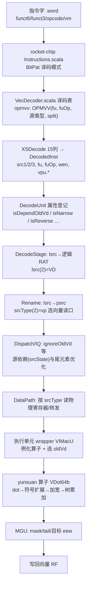

# E. 给香山昆明湖 V2 加一条向量指令的完整改动清单（vqdot 实战版）

> 团队：AsyncSys ｜ 以 `vqdot.vv/vqdotu.vv/vqdotsu.vv`（对标 SiFive Xsfvqdotq）为实例
> 价值：把"加一条自定义向量指令"从"改译码+写算子"的朴素认知，补全为**全流水线属性登记**。
> 本清单由一次真实的老 bug 提炼（见《oldVd累加bug根因与修复.md》）：漏掉其中任何一个"按指令类别"的布尔判定，都会出现功能正确但 Difftest 报错的隐蔽故障。

---

## 0. 总览（数据/控制流）



---

## 1. 必须改动的文件（共 7 处 RTL/译码 + 1 处参考模型 + 测试）

### 1.1 指令编码：rocket-chip `Instructions.scala`
- 位置：`rocket-chip/src/main/scala/rocket/Instructions.scala`
- 内容：3 条 BitPat（vm 位留 `?`，与 VMACC_VV 同构，仅 funct6 不同）
  - `VQDOT_VV` funct6=101100（SS）、`VQDOTU_VV` 101000（UU）、`VQDOTSU_VV` 101010（SU）
  - 统一 opcode=0x57、funct3=010(OPMVV)、vd=[11:7]、vs1=[19:15]、vs2=[24:20]

### 1.2 译码表：`backend/decode/VecDecoder.scala`
- 在 `opmvv` 表加入（与 VMACC_VV 逐字同构，只换 fuOp）：
  ```scala
  VQDOT_VV   -> OPMVV(T, FuType.vimac, VimacType.vdot,   F, T, F, UopSplitType.VEC_VVV),
  VQDOTU_VV  -> OPMVV(T, FuType.vimac, VimacType.vdotu,  F, T, F, UopSplitType.VEC_VVV),
  VQDOTSU_VV -> OPMVV(T, FuType.vimac, VimacType.vdotsu, F, T, F, UopSplitType.VEC_VVV),
  ```
- 第一个参数 `vdRen=T` → `src3=vp`（第三个源是旧 vd）。
- `UopSplitType.VEC_VVV`：LMUL=1 时 1 个 uop（已在 UopInfoGen 确认 split=lmul）。

### 1.3 算子操作码：yunsuan
- `yunsuan/.../yunsuan/package.scala`：`VimacType.vdot/vdotu/vdotsu`，用 `LiteralCat(符号位, FMT.VVV, VimacOpcode.vdot)`。
- `yunsuan/.../encoding/Opcode/VimacOpcode.scala`：`vdot=111`，并保证 `isMacc` 包含 vdot（决定算子内部加 oldVd）。

### 1.4 执行单元 wrapper：`backend/fu/wrapper/VIMacU.scala`
- 例化 `Seq.fill(2)(Module(new VDot64b))`（128bit=2×64bit），连 fire/vs1/vs2/oldVd，`isMacc:=true.B、widen:=false.B`。
- 输出拍按 `VimacOpcode.vdot` 选择 vdot 结果：`outVd`、`outEew`（vdot 恒 e32）、`outVxsat`。
- MGU：`narrow:=0.B、dstMask:=0.B`；mask/tail/ta/ma/vl/vlmul 接通用向量控制。

### 1.5 运算核：`yunsuan/.../vector/vectorIMAC/VDot64b.scala`
- 接口对齐 VIMac64b（64bit/2 寄存器拍）。
- S0 组合：`pre = wrap32s( Mux(isMacc, dot+old, dot) )`；两级流水 `s1→s2`；`io.vd`。
- 每个 32bit 元素内 packed 4×int8：乘积符号扩展到 32bit、4 项归约、wrapping 累加。

### 1.6 ★属性登记（最容易漏，本次 bug 根源）：`backend/decode/DecodeUnit.scala`
- **`vmaInsts` 必须加入 3 条新指令**：
  ```scala
  VQDOT_VV, VQDOTU_VV, VQDOTSU_VV,
  ```
  否则 `isDependOldVd=false` → 发射/分派侧 `ignoreOldVd` 把 src2 改成立即数 0，oldVd 被吞。

### 1.7 功能单元配置：`backend/fu/FuConfig.scala`
- 复用 `VimacCfg`（`srcData=Seq(VecData×3, V0Data, VlData)`、latency=2、writeVecRf、piped、destDataBits=128、maskWakeUp/vconfigWakeUp）。vqdot 与 vmacc 共用，无需新增 FuConfig。

### 1.8 参考模型 NEMU
- `instr/rvv/vqdot.h`：SEW=32 packed 8bit 软件语义，`res=(int32)(old&0xffffffff)+acc` 自然回绕；支持 LMUL/mask/tail。
- `EHelper` 三枚（vqdot/vqdotu/vqdotsu），`decode.h` 的 vopmvv、`isa-all-instr.h`、`exec.h` 接线。

### 1.9 测试程序（nexus-am app）
- `vqdot_run`：先 `csrs mstatus, 0x600` 置 VS=Dirty；`vsetvli e32,m1,ta,ma`；自定义指令用 `.word` 宏（vm=1）。

---

## 2. DecodeUnit 中"按指令类别"的布尔判定——逐项核对表

| 判定 | 含义 | vqdot 是否加入 | 原因 |
|---|---|---|---|
| **`vmaInsts`→isDependOldVd** | 乘加，active 元素也要 old vd | **必须（已加）** | vd=acc+Σ 乘积 |
| `narrowInsts` | 结果 SEW 减半（VNSRL/VNCLIP…） | 否 | 结果仍是 SEW=32，只是元素内 packed |
| `maskDstInsts` | 目标是 mask 寄存器 | 否 | 目标是普通向量 vd |
| `maskOpInsts` | mask 逻辑运算 | 否 | 不涉及 |
| `needReverseInsts` | 减法交换源（VRSUB/VFSUB） | 否 | 乘法+加法，乘法交换律、累加固定 |
| `vextInsts` | 零/符号扩展（VZEXT/VSEXT） | 否 | 非扩展指令 |
| `wfflagsInsts`/`*FrmInsts` | 浮点写标志/舍入模式 | 否 | 整数 wrapping，无舍入 |
| `isWritePartVd`(VEC_VRED/0XV/VWW) | 只写部分 vd | 否 | LMUL=1、VEC_VVV 写完整 vd |
| `isVlx`（indexed load）/`isFof` | 访存特例 | 否 | 纯运算 |
| `isReverse`（DecodeStage 交换 src0/1） | 同上 | 否 | 同 needReverse |

> 另：执行层 `VIMacSrcTypeModule.widenIllegal` 处理加宽非法（vqdot widen=false，天然不触发）。

---

## 3. 受 isDependOldVd 影响的两个对称位置（修复后自动生效）

1. `backend/issue/EntryBundles.scala`（srcIdx==2）：
   ```scala
   ignoreOldVd := srcIsVec && vlIsNonZero && !isDependOldVd && (ignoreTail || ignoreWhole)
   srcStatusNext.srcType  := Mux(ignoreOldVd, SrcType.no, srcStatus.srcType)
   srcStatusNext.dataSources := Mux(ignoreOldVd -> DataSource.imm, ...)
   ```
2. `backend/dispatch/NewDispatch.scala`：同构的 `ignoreOldVd`，并把 `srcType(numRegSrcVf-1)` 改写为 `SrcType.no`。

**触发条件（我们的测试正好命中）**：`vl=vlmax`（e32/m1 时 vl=4）、`vm=1`、`vta=1` ⇒ `ignoreTail=true`。乘加指令若未声明依赖 oldVd，就会被错误地当成"不需要旧 vd"，src2 喂 0。

---

## 4. 尚待完善（不阻塞 MVP）
- **SEW 合法性**：SiFive 规范要求 SEW=32，否则 illegal；当前依赖测试固定 e32，后续应在 `VIMacSrcTypeModule` 或译码层加 SEW 判定。
- 扩展：LMUL>1、vm=0 元素 mask、`.vx`（OPMVX funct3=110）、INT16（SEW=64 packed 4×int16→int64）、INT4、BF16/FP16。

---

## 5. 验证矩阵
- yunsuan treadle 单测（VDot64b，随机 oldVd/isMacc）全绿。
- VCS Difftest（MinimalConfig，NEMU golden）：VMACC 对照 + DOT+OLD（108/208/308/408）+ OLDONLY（100/200/300/400）+ 边界 ss/uu/su + 3 类型×100 随机（含非零 old）→ **HIT GOOD TRAP、zero different**。
