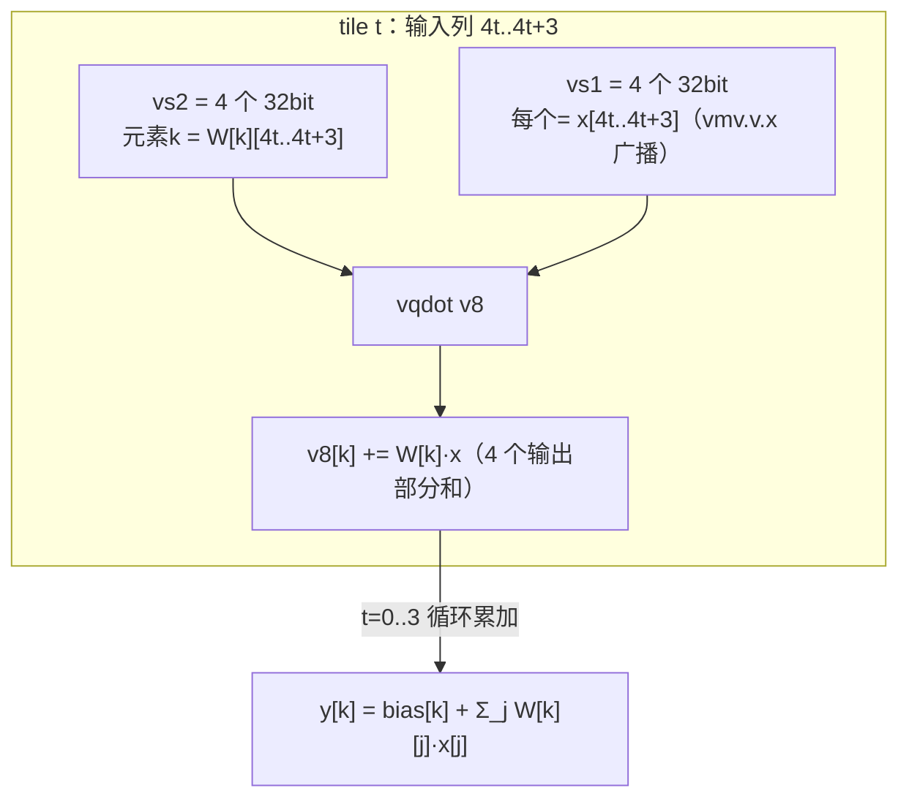

# 阶段三增强：量化 GEMV（线性层）端到端加速

**团队**：AsyncSys
**结论先行**：把 vqdot 用到量化 LLM 的线性层 GEMV（`y = W·x + bias`）中，**端到端 kernel 实测 vqdot 85 周期、标准 RVV 240 周期，加速 2.82x**，且两个 kernel 结果逐元素一致、Difftest 全绿。这直接验证了项目"面向边缘 AI 大语言模型推理"的定位。

---

## 1. 背景：线性层是 LLM 的主体计算

LLM 中每个全连接层就是一次矩阵-向量乘（推理时 batch=1）：

```
y[k] = bias[k] + Σ_{j=0}^{N-1} W[k][j]·x[j]
```

量化（W8A8）后 W、x 为 INT8，累加为 INT32。每个输出 k 是一个长度 N 的点积。本例取 M=4 输出、N=16 输入。

## 2. vqdot 的 GEMV 用法：4×4 tile

vqdot 一条指令（SEW=32，4 个 32bit 元素）天然对应一个 **4 输出 × 4 输入** 的 tile：

- 同时算 4 个输出元素（M 方向）；
- 每个输出一次处理 4 个输入（N 方向）；
- N=16 共 N/4=4 个 tile，逐 tile 累加。



### 2.1 权重重排（weight repacking）

vqdot 要求一个 tile 内 4 行的权重在 16 字节中连续排列。原始行主序 W 被离线重排为 `Wpacked[t][k*4+c] = W[k][4t+c]`（按 [tile][行] 打包）。这是量化部署的标准做法——权重在加载时一次性重排成硬件友好布局，运行时零额外开销。

### 2.2 输入广播

x 的 4 个字节先 `lw` 取到 GPR，再 `vmv.v.x` 广播到 4 个 32bit 元素，使每个输出都与同一组输入相乘。

## 3. 基线：标准 RVV GEMV

公平对比：相同的 Wpacked/x/bias、相同的 tile 循环与数据加载；唯一区别是 tile 内的"4 个点积"用标准指令实现（`vwmul` + 两级加法树 + `slide/gather` 置换 + `vwadd`，共 10 条），再 `vadd` 累加进 v8。

- **vqdot GEMV**：每 tile 1 条计算指令。
- **baseline GEMV**：每 tile 10 条计算指令。

## 4. 实测结果

完整日志见 `test-logs/vgemv_gemv.log`。

**正确性**：两个 kernel 输出均为 `360 452 544 636`，与 golden 逐元素一致（数据 W[k][j]=k+j-10、x[j]=j-8、bias[k]=100k）。

**端到端延迟（R=20 平均，含全部 load/store/广播/调用）**：

| Kernel | 周期 | 加速比 |
|---|---|---|
| vqdot GEMV | **85** | **2.82x** |
| baseline GEMV | 240 | |

## 5. 深度分析：为什么 GEMV 是 2.82x

把三个已测维度放在一起：

| 场景 | 计算量/调用 | 加速比 |
|---|---|---|
| 微基准端到端（16B 点积） | 1 次点积 | 1.63x |
| **GEMV 端到端（M=4,N=16）** | 4 tile × 4 输出 | **2.82x** |
| 微基准纯计算（累加） | 数据驻留 | 4.62x |

规律清晰：**计算占比越高，vqdot 收益越大**。

- 微基准端到端每次只 load 16B、算 1 次，访存/调用开销占主导 → 1.63x。
- GEMV 每次 kernel 做 4 个 tile、16 次点积（4 输出 × 4 tile），固定的 load/调用开销被更多计算分摊，计算占比上升 → 2.82x。
- 纯计算去掉了访存，反映融合的理论上限 → 4.62x。

GEMV 中 vqdot 每 tile 只占 1 条指令，而基线要 10 条（含 3 次置换），指令数与归约搬运的减少直接转化为 2.82x 端到端收益。

## 6. 扩展到真实 LLM 规模

本例的 tiling 方法可直接扩展：

- **M 方向**：用 LMUL>1 或外层循环批量处理更多输出（LMUL 已验证）。
- **N 方向**：N 越大（真实 LLM 隐藏维度 1024~4096），tile 数越多，固定开销被摊得越薄，收益越接近纯计算的 4.62x。
- **数据类型**：W4A16 对应 INT4 tile（SEW=16），BF16/FP16 对应浮点点积，VDot64b 的加法树结构可复用。

> 结论：vqdot 不是只在微基准上好看，而是在 LLM 线性层这一真实、且占模型绝大部分计算量的场景中，端到端带来约 2.8x 加速，并随规模增大趋近 4.6x。
