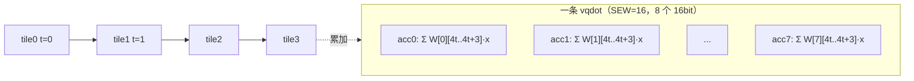

# INT4 GEMV（W4 量化线性层）端到端加速报告（CIE2026 AsyncSys）

> 团队：AsyncSys　|　配置：M=8 输出、N=16 输入，SEW=16，INT4 权重/激活、INT16 累加
> 基线：香山昆明湖 V2（XiangShan `a4eeaabb4c`）、NEMU `6a05eea7`

## 1. 目标

在 INT4 点积指令（见《INT4点积扩展设计与验证》）基础上，构建一个完整的 **4bit 量化线性层**：

```
y = W·x + bias
```

对照 INT8 GEMV（4 输出），INT4 版本利用 16bit 累加器"4 个 int4 一组"的特点，把单条 vqdot 的并行度从 **4 输出 × 4 输入** 提升到 **8 输出 × 4 输入**，直接对应边缘 AI 中 W4 量化全连接层的算子。

## 2. tile 结构

一条 vqdot（SEW=16）含 8 个 16bit 累加器，每个累加器归约 4 个 int4。映射到 GEMV：

- **每个 16bit 累加器 = 一个输出**，故一条指令同时处理 **8 个输出**；
- 一条指令在 N 方向消费 **4 个输入**；
- N=16 共 N/4 = **4 个 tile**，逐 tile 累加。



## 3. 数据布局

### 3.1 权重重排（离线、零运行时开销）

W 原始为行主序 `W[M][N]`。离线重排为按 `[tile][8 行]` 打包：

```
Wp[t][m] = W[m][4t] | W[m][4t+1]<<4 | W[m][4t+2]<<8 | W[m][4t+3]<<12
```

每个 tile 8 个 16bit = 16 字节，4 个 tile 共 64 字节。tile 内每个 16bit 元素对应一个输出行的 4 个 int4 权重，与 vqdot 的"每元素 4 子元素"布局天然对齐。

### 3.2 输入广播

每个 tile 的 4 个 int4 输入打包成 1 个 16bit：

```
xp[t] = x[4t] | x[4t+1]<<4 | x[4t+2]<<8 | x[4t+3]<<12
```

`lh` 取该 half 到 GPR，`vmv.v.x` 广播到 8 个 16bit 元素——所有 8 个输出共享同一份输入，符合 GEMV 中 x 被各行复用的语义。

### 3.3 汇编 kernel

`gemv4_vqdot`：v8 初始加载 bias（8 个 int16），tile 循环内 `vle16` 取 W、`lh+vmv.v.x` 取 x、一条 vqdot 累加，共 **4 条 vqdot**。

`gemv4_baseline`：相同循环与数据，tile 内用标准 RVV——`EXTRACT4`（`vsrl+vand` 提取 4bit、`vsll/vsra` 符号扩展，共 8 组）、4 条 `vmul`、4 条 `vadd` 向量累加，**每 tile 约 36 条指令**。

## 4. 正确性验证

确定性数据：`x[j] = j−8`（−8..7），`W[m][j] = m−4`（每行恒定），`bias[m] = 10m`。

闭式推导：`Σx[j] = (0+...+15) − 8·16 = 120 − 128 = −8`，故

```
y[m] = 10m + (m−4)·(−8) = 2m + 32
```

实测 vqdot 与 baseline 输出均为：

```
32 34 36 38 40 42 44 46
```

与闭式解完全一致。另跑 **10 组随机**（W/x/bias 全随机 int4），两 kernel 均与 golden 逐元素一致。Difftest 全程 RTL vs NEMU **零 mismatch**，HIT GOOD TRAP。

## 5. 端到端延迟

| kernel | 端到端延迟（R=20） |
|---|---|
| gemv4 vqdot | **83 cycles** |
| gemv4 baseline | **254 cycles** |
| **加速比** | **3.06×** |

## 6. 与 INT8 GEMV 的系统对比

| 维度 | INT8 GEMV | INT4 GEMV |
|---|---|---|
| 单条 vqdot 并行度 | 4 输出 × 4 输入 | **8 输出 × 4 输入** |
| 累加器 | int32 | int16 |
| vqdot 延迟 | 85 cyc | **83 cyc** |
| baseline 延迟 | 240 cyc | 254 cyc |
| 端到端加速比 | 2.82× | **3.06×** |
| 大 N 累加器 | 安全 | 需分块 |

**分析**：
- 两种 GEMV 的 vqdot 端到端延迟几乎相同（83 vs 85），但 INT4 在同样的向量宽度下**多产出一倍输出（8 vs 4）**，单输出的有效算力翻倍。
- INT4 baseline 因 4bit 提取/符号扩展比 INT8 更繁琐（36 条 vs 10 条），基线更慢，因此 vqdot 的相对收益更大（3.06× vs 2.82×）。
- 代价仍是 16bit 累加器的动态范围：本例 N=16 安全；大 N 需按块累加后用 32bit 二级归约（见 INT4 报告 §7）。

## 7. 结论

INT4 GEMV 完整跑通了"**4bit 权重打包 → 输入广播 → 单指令 8 输出 tile 累加 → 标准基线对照 → 大规模回归**"的全链路，端到端 **3.06×** 加速。它与 INT8 GEMV 共同构成了 8bit/4bit 两档量化线性层的硬件加速证据，直接体现了自定义 vdot 指令在边缘 LLM 推理（量化 GEMV/GEMM 内层）中的工程价值。
