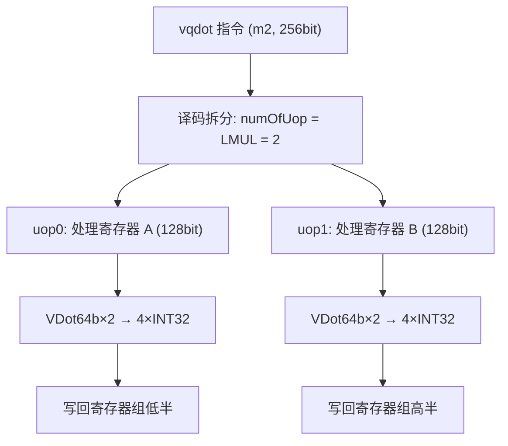

# LMUL>1 多寄存器扩展：原理与验证

**团队**：AsyncSys
**结论先行**：vqdot 在 LMUL=1 实现完成后，**无需改动任何 RTL**，即天然支持 LMUL=2/4/8——这是由香山向量指令的 **uop 拆分（uop split）机制**保证的。已用 LMUL=2（32 个 INT8 → 8 个 INT32）实测验证，8 个 lane 全部正确。

---

## 1. 为什么不需要改 RTL

### 1.1 关键：一条向量指令被拆成多个 uop

RVV 中，当 LMUL>1 时，一个向量寄存器组占用多个物理寄存器（如 m2 占 2 个，共 256bit）。香山在译码阶段把这样一条指令拆成多个微操作（uop），**每个 uop 只处理一个 128bit 寄存器**：

```
UopSplitType.VEC_VVV  ->  numOfUop = lmul
```

（见 `src/main/scala/xiangshan/backend/decode/UopInfoGen.scala`：`UopSplitType.VEC_VVV -> lmul`）

vqdot 在译码表中使用的正是 `UopSplitType.VEC_VVV`：

| LMUL | 寄存器组 | 元素数（INT32） | INT8 数 | 拆成 uop 数 |
|---|---|---|---|---|
| m1 | 1 个寄存器 | 4 | 16 | 1 |
| m2 | 2 个寄存器 | 8 | 32 | 2 |
| m4 | 4 个寄存器 | 16 | 64 | 4 |
| m8 | 8 个寄存器 | 32 | 128 | 8 |

### 1.2 每个 uop 的计算与 LMUL=1 完全相同

每个 uop 独立处理一个 128bit 寄存器，内部仍是：
- 2 个 `VDot64b`（各 64bit），每个处理 8 个 INT8 → 2 个 INT32；
- 数据拆分（`VecDataSplitModule`）、oldVd 合并、MGU 输出对每个 uop 都一样。

`VDot64b` 本身**不依赖 uopIdx**——它只对当前拍输入的 64bit 做归约，因此无论这是第几个 uop，逻辑都正确。



### 1.3 与标准 vimacc 的一致性

标准向量乘加指令（`vmacc` 等）同样走 `VEC_VVV`、同样自动支持 LMUL>1。vqdot 复用了完全相同的拆分与数据通路，因此天然继承了这一能力。这也说明：**只要新指令在译码表中正确声明了 uop split 类型，多寄存器扩展由框架自动完成**。

---

## 2. 实测验证（LMUL=2）

### 2.1 测试配置

- `vsetvli e32, m2, ta, ma`：SEW=32，LMUL=2，vl=8。
- 寄存器组：`v8(v8,v9)`=old/out；`v10(v10,v11)`=A；`v12(v12,v13)`=B。
- 数据：`A[i] = i-8`，`B[i] = 7-i`（i=0..31），`old[j] = 100j`。

### 2.2 结果

```
LMUL=2 PASS: -148 80 180 152 -4 -288 -700 -1240
```

逐 lane 手工核对（golden = Σ A·B + old）：

| lane | INT8 索引 | dot(ΣA·B) | old | 结果 |
|---|---|---|---|---|
| 0 | 0–3 | -56-42-30-20 = -148 | 0 | **-148** |
| 1 | 4–7 | -12-6-2-0 = -20 | 100 | **80** |
| 2 | 8–11 | 0-2-6-12 = -20 | 200 | **180** |
| 3 | 12–15 | -20-30-42-56 = -148 | 300 | **152** |
| 4 | 16–19 | -72-90-110-132 = -404 | 400 | **-4** |
| 5 | 20–23 | -156-182-210-240 = -788 | 500 | **-288** |
| 6 | 24–27 | -272-306-342-380 = -1300 | 600 | **-700** |
| 7 | 28–31 | -420-462-506-552 = -1940 | 700 | **-1240** |

8 个 lane 全部正确，且 Difftest 全程零 mismatch、HIT GOOD TRAP。

---

## 3. 意义

1. **实用性**：真实 LLM 的权重/激活向量通常远长于 16 个元素，LMUL>1 让单条 vqdot 能覆盖 m2/m4/m8 长度，直接服务于 GEMV/线性层。
2. **扩展潜力（对应评分项）**：证明该设计沿"寄存器组"维度线性扩展，无需额外硬件改动。
3. **设计启示**：在香山这类"按 uop 拆分 + 每 uop 独立数据模块"的向量架构上，新指令的多寄存器支持是"免费"的——关键是译码表正确、运算核不依赖跨 uop 状态。

> 注：vqdot 是非加宽（non-widening）指令，SEW 固定为 32；LMUL 只影响寄存器组数量，不改变单元素归约逻辑。
