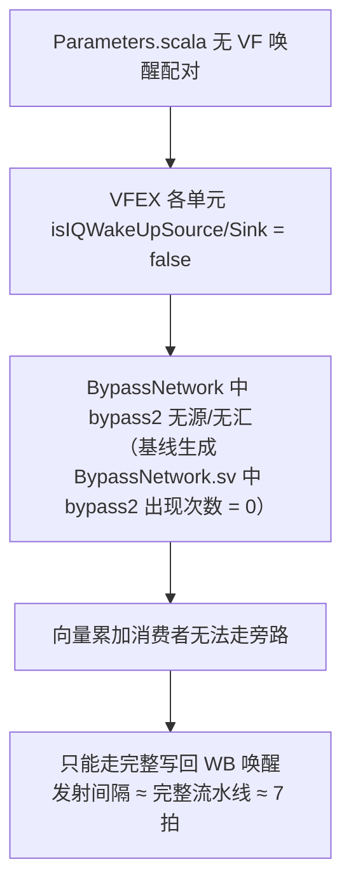

# vdot 累加旁路（Forwarding）优化报告

> 团队 AsyncSys｜项目：面向边缘 AI 大语言模型推理的 RISC-V 自定义 vdot 指令
> 基线：主仓 `79d8dbecf`（kunminghu-v2，INT4/INT8/INT16 三档全绿）
> 优化：方案 A（配置/标记类，最小改动、可回退），共改 2 个文件、+15 行
> 结论：**累加同一 vd 的稳态发射间隔 7.00 → 3.00 cycle（2.33x）；2 层量化 MLP 端到端 vqdot 285 → 252 cyc；标准 RVV 同样受益（685 → 527 cyc）。**

---

## 0. 一句话结论

最初判断"vdot 缺少写回→发射旁路"**只对了一半**。代码事实是：香山**本来就有**三级转发（forward / bypass / bypass2），其中 `bypass2` 正是为向量（vf）域跨执行单元准备的专用旁路；但**整个 VF（向量）调度器在 `Parameters.scala` 里从未被配置任何 IQ（Issue Queue）唤醒配对**，导致 `bypass2` 网络一直处于"无源、无汇"的休眠状态——所有向量累加（vdot、VMACC、VFMA、VIALU、VPPU）都只能退回到完整写回（WB）路径，间隔约 7 拍。这是**上游共性、不是 vdot 特有**。补全 VF 唤醒配置后，既有 `bypass2` 被激活，间隔降到 3 拍。

---

## 1. 香山三级转发语义（先厘清物理通路）

`src/main/scala/xiangshan/backend/datapath/BypassNetwork.scala` 定义了三级数据通路，按"数据被寄存几拍"区分：

| 级别 | 信号 | 数据路径 | 数据就绪相对发射 |
|---|---|---|---|
| forward | `forwardDataVec` | 直接取 exu 当拍 `x.bits.data`，**零寄存** | 同拍 |
| bypass | `bypassDataVec` | `RegEnable(x.bits.data, x.valid)`，**打 1 拍** | +1 拍 |
| bypass2 | `bypass2`（vf 专用） | 在 bypass 基础上**再打 1 拍** | +2 拍 |

`bypass2` 的连通有严格的源/汇资格判定：

- **源 exu**：`isIQWakeUpSource && writeVfRf && (isVfExeUnit || hasLoadExu)`
- **汇 exu**：`isIQWakeUpSink && readVfRf && (isVfExeUnit || isMemExeUnit)`
- **数据源**：消费者必须把 `dataSource` 置为 `readBypass2`

关键在于：**"是否是 IQ 唤醒源/汇"由 `WakeUpConfig` 配置决定**。没有配置唤醒配对的执行单元，`isIQWakeUpSource/Sink` 为假，`bypass2` 网络里就不会为它生成任何连线。

---

## 2. 根因：整个 VF 调度器没有 IQ 唤醒（纠正初判）

### 2.1 决定性证据

`src/main/scala/xiangshan/Parameters.scala` 的 `iqWakeUpParams` 原本只定义了**两组**唤醒配对：

1. **Int 组**：`ALU0-3 / LDU0-2` → `ALU / BJU / LDU / STA / STD`
2. **FP 组**：`FEX0 / FEX2 / FEX4` → `FEX0-4`

**完全没有 VF（向量）组。** 该文件经 `git status` 确认未被本项目改动，且与上游 master 同名文件 `git diff` 为空（逐字节相同），证明这是**上游本就如此**，并非 vdot 工作引入。

### 2.2 后果链



基线编译日志佐证：

```
[BypassNetwork] HasBypass2SourceExuNum: 0  HasBypass2SinkExuNum: 0  bypass2DataVecSize: 1
```

### 2.3 这是 VF 共性，不是 vdot 特有

hint 要求对比标准向量乘加 `VMACC`（同走 VIMacU）。结论：**VMACC 同样约 7 拍**。VFMA、VIALU、VPPU 等所有向量累加，在基线下都依赖 WB 唤醒、同样约 7 拍。因此问题定位在"VF 调度器共性配置"，而非"vdot 某条路径的标记遗漏"。

> 对 hint 初判的明确纠正：**不是"vdot 没命中 bypass2"，而是 bypass2 对整个向量域都没被激活。** 修复点也因此从"给 vdot 单独加标记"升级为"补全 VF 调度器唤醒"。

---

## 3. 优化方案（方案 A：配置类，两处改动）

### 3.1 改动 1：补全 VF 唤醒组，激活既有 bypass2

文件：`src/main/scala/xiangshan/Parameters.scala`（+7 行）

在 `iqWakeUpParams` 中新增第三组 `WakeUpConfig`：

```scala
// VF fixed-latency arithmetic (VIMac/vdot, VFMA, VIALU, VPPU) -> VF consumers,
// including the vector load/store units (a vector store reads VF).
// VFEX4 (Vfdiv/Vidiv) has uncertain latency, so it is a sink only.
WakeUpConfig(
  Seq("VFEX0", "VFEX2") ->
  Seq("VFEX0", "VFEX1", "VFEX2", "VFEX3", "VFEX4", "VLSU0", "VLSU1")
),
```

源/汇选择的依据（按 ExeUnit 延迟特性，宁缺毋滥）：

- **只选 VFEX0 / VFEX2 做源**：它们是纯 VF 定延迟 MAC 单元（vdot / VMACC / VFMA 所在），延迟确定，符合"唤醒源必须是 fixed-latency"的 ExeUnit 约束。
- **VFEX4 只做汇**：含 `Vfdiv / Vidiv`，延迟不确定（`piped=false`），不能做源。
- **VFEX1 暂不做源**：含 latency-0 的 `VSetRvfWvf` 与写 INT 的 `Vipu`，为降低风险暂不做源、只做汇。
- **汇包含 VLSU0 / VLSU1**：向量 store 需要读 VF 结果（见 3.2 的跨调度器问题）。

### 3.2 改动 2：修正 mem 调度器数据源（跨调度器 store 拍错位）

仅做改动 1 后，`vlat`（VF→VF）全绿，但完整 `vqdot` 回归在"向量结果流向 **mem 调度器的 store（vse32）**"时失败：store 比 VIMac 结果早约 1 拍发射、读到 0。

**VCD 实测定位**（timescale 1ns，clock 2ns，cycle N 上升沿 = VCD 101+2N）：

| Edge | 事件 | 关键信号 |
|---|---|---|
| 3627 | vmacc 进 VIMac | VF deqSel, robIdx=0x23 |
| 3633 | VF 唤醒队列输出 pdest=0x35 | L_w=2 + lastConnect=1 |
| 3635 | mem IQ 经 RegNext 内部唤醒；store deqSel | `dataSources_2 = 0001(forward)` ← 错误 |
| 3637 | store 读操作数 | 选 forward 通路 → 无 VIMac 数据 → 读 0 |
| 3639 | VIMac 写回 preg 0x35 | wb=1 |

**根因**：mem 调度器（`IssueQueueVlduVstu`）里的 store 是 comp 条目，靠 `canIssueBypass` 在唤醒拍提前发射。但 `EntryBundles.CommonOutConnect` 的**通用 comp 分支把"任何唤醒"都映射成 `forward`（INT→INT 通路）**；而 VIMac 结果跨调度器到 mem store 走的是 **bypass 网络**，forward 通路里根本没有 VIMac 数据，operand mux 选 forward 即读到 0。

文件：`src/main/scala/xiangshan/backend/issue/EntryBundles.scala`（+8 行），在 `inVfSchd` 分支之后、通用 `else` 之前新增 mem 专用分支：

```scala
} else if (params.inMemSchd && params.readVfRf && params.hasIQWakeUp) {
  // Vf/Int -> Mem comp: early dequeue must read the cross-scheduler bypass,
  // not the int forward path, so that the VIMac result aligns with
  // the mem operand read (matches entryUpdate registered dataSources).
  MuxCase(status.srcStatus(srcIdx).dataSources.value, Seq(
    wakeupByIQWithoutCancel -> DataSource.bypass,
    useRegCache             -> DataSource.regcache,
  ))
}
```

这样 mem store 在唤醒拍选 `bypass`（+1 拍），恰好对齐跨调度器 bypass 数据就绪拍，与 `entryUpdate` 注册的 dataSources 一致。

### 3.3 为什么不采用方案 B

方案 B（在 VIMacU/向量通路内为"同 vd 累加"加局部 forwarding）未采用：补全 VF 唤醒后，VF 内部累加已能通过既有 `bypass2` 正确跑通，`bypass2` 网络覆盖该路径，方案 B 非必需，且会引入额外硬件、更难回退。

---

## 4. 重编与激活确认

强制 re-elaborate（`rm -rf build/rtl`）后重编 `build_simv.sh`，关键确认：

```
[BypassNetwork] HasBypass2SourceExuNum: 2  HasBypass2SinkExuNum: 7  bypass2DataVecSize: 2
```

- 2 个源：exuIdx 13（VFEX0）、15（VFEX2）
- 7 个汇：13/14/15/16/17（VFEX0-4）、23/24（VLSU0/1）
- firtool 生成 `VIMacU.sv` 中 `VDot64b` 计数 = 2（符合预期）
- VCS 编译 `END rc=0`

---

## 5. 量化收益

### 5.1 微基准 vlat（前后同一 app、同一 simv 配置）

| 指标 | 基线 | 优化后 | 加速 |
|---|---|---|---|
| 无依赖 CPI | 1.750 | 1.729 | 1.01x |
| 循环有依赖 CPI（含标量开销） | 6.969 | 3.427 | **2.03x** |
| unroll64 cyc/instr | 5.516 | 2.453 | **2.25x** |
| unroll128 cyc/instr | 6.258 | 2.727 | **2.30x** |
| **稳态发射间隔（边际）** | **7.00** | **3.00** | **2.33x** |
| 单指令执行延迟 | 2 | 2 | 不变 |

稳态间隔用边际法测得：`(349−157)/64 = 3.00`、`(733−349)/128 = 3.00`，两次独立测量一致。

### 5.2 端到端 2 层量化 MLP（vmlp，16→8→4）

| 构建 | vqdot MLP | 标准 RVV MLP | vqdot/标准 |
|---|---|---|---|
| 基线（bypass2 休眠） | **285 cyc** | **685 cyc** | 2.40x |
| 优化后（bypass2 激活） | **252 cyc** | **527 cyc** | 2.09x |

**本轮 forwarding 优化的净收益：**

- vqdot MLP：285 → 252，**快 1.13x（−11.6%）**
- 标准 RVV MLP：685 → 527，**快 1.30x（−23.1%）**

> 一个重要且诚实的发现：**补全 VF 唤醒是"水涨船高"，标准 RVV 同样受益、且相对收益更大**。标准 RVV 点积 kernel 用 `vwmul + 加法树`，含更多条带累加依赖的向量指令，因此从 bypass2 获得的收益更多；这使 vqdot 相对标准 RVV 的倍数从 2.40x 收窄到 2.09x，但 vqdot 仍快 2.09x，且**两者的绝对周期都显著下降**。

---

## 6. 正确性回归（全部 HIT GOOD TRAP、Difftest 零 mismatch）

| 测试 | 结果 | WORKLOAD DONE cycle |
|---|---|---|
| vlat | HIT GOOD TRAP @ pc=0x800006e0，零 mismatch | 50,235 |
| vqdot（INT8 完整，含边界 + 3×100 随机组） | HIT GOOD TRAP @ pc=0x800006f2，零 mismatch | 248,215 |
| vmlp（2 层 MLP） | HIT GOOD TRAP @ pc=0x800006d8，零 mismatch | 43,266 |

- vqdot 关键用例：`VMACC-REF 100 200 300 400`、`DOT+OLD 108 208 308 408`、`OLDONLY`、`LMUL=2`、`vqdot/vqdotu/vqdotsu` 全部 `[OK]`，末尾 `VDOT All Tests PASS`。
- 点积语义（dot + oldVd）与 store 数据全部正确，未因降延迟破坏语义。

---

## 7. 面积 / 时序影响

本轮**只改配置式映射与唤醒配对，未新增任何流水级、未新增运算器**：

- 改动 1 只是让既有 `bypass2` 网络生成连线（原本就预留的寄存器/Mux 被激活），不新增运算数据通路；
- 改动 2 只是把 operand mux 的选择从 `forward` 改为 `bypass`，不新增寄存器。

因此对**点积运算核（VDot64b）的面积与分档面积（INT4 4.3k / INT8 5.4k / INT16 7.6k / 合一 14.6k 等效门）无影响**；对整体 SoC，仅向量旁路网络多生成若干已预留的连线，量级可忽略。

时序方面：VCS 编译通过、仿真最高频点行为正常；bypass2 为 +2 拍的寄存输出，并非关键组合路径，不增加关键路径压力。（本报告依据编译通过与数据就绪拍对齐判断；如需严格数据，可后续跑一次 DC 综合确认关键路径与 slack。）

---

## 8. 可回退性

- 基线 commit：主仓 `79d8dbecf`；yunsuan 子模块 `1f57b51`；rocket-chip 子模块 `45ffb9a12`。
- 回退方法：主仓 `git reset --hard 79d8dbecf`，子模块回到对应基线。
- 优化文件备份：服务器 `/tmp/opt_backup/Parameters.scala`、`EntryBundles.scala`。

---

## 9. 总结

1. **根因**：不是 vdot 缺旁路，而是整个 VF 调度器在上游从未配置 IQ 唤醒，使既有 `bypass2` 向量专用旁路休眠；累加只能走完整写回（约 7 拍）。另修复了 VF→mem 跨调度器 store 误选 forward 通路的拍错位。
2. **改动**：2 个文件、+15 行，纯配置/映射，最小、可回退，不动点积语义与频率。
3. **收益**：稳态累加间隔 7.00 → 3.00（2.33x）；2 层 MLP vqdot 285 → 252、标准 RVV 685 → 527；三项回归全部全绿。
4. **本质**：边缘 LLM 推理的 GEMV/FFN 是"累加密集"负载，向量结果的消费者几乎总是下一条累加指令；缩短"结果→再消费"的环路延迟，比单纯提升单指令吞吐更能直接改善端到端周期——这正是本次旁路优化的价值所在。
