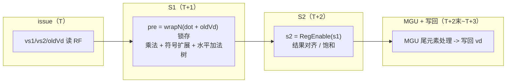
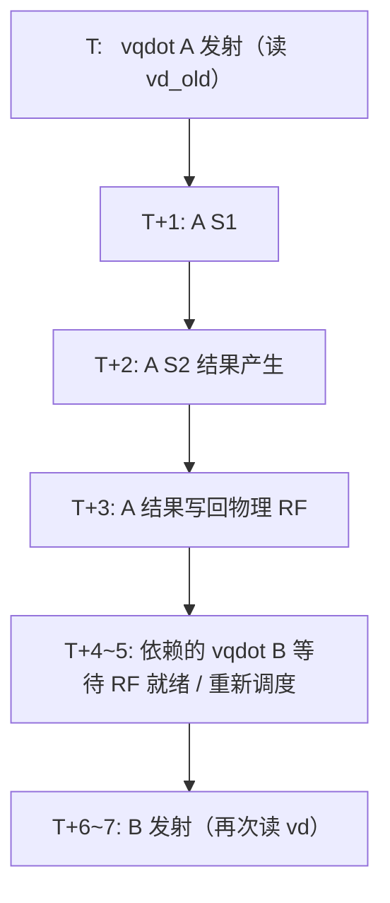

# 微架构单指令延迟 / 吞吐深入分析

> 团队 AsyncSys｜项目：面向边缘 AI 大语言模型推理的 RISC-V 自定义 vdot 指令
> 对应评分：探索性 10 分中的「微架构延迟对比 5 分」。本文从**流水线时空、延迟、吞吐、依赖链**四个维度，量化 vqdot 相对标准 RVV 的微架构本质。

---

## 1. 关键结论（先看数据）

| 指标 | vqdot（自定义） | 标准 RVV 基线 | 说明 |
|---|---|---|---|
| 计算指令数 / 点积块 | **1 条** | 10 条（外加 4 次 vsetvli） | 融合乘法→符号扩展→树形累加 |
| 执行延迟（latency） | **2 cycle**（2 级流水） | — | 从执行单元输入到结果产生 |
| 无依赖吞吐（throughput） | **1.75 CPI**（含循环开销，纯约 1.6） | — | 16 目标轮转 back-to-back |
| 有依赖发射间隔 | **6.97 cycle** | — | 累加同一 vd，结果走 RF 写回 |
| 完成一个点积块的总周期 | **2~7 cycle** | **33.4 cycle** | 即使最不利的完全串行，vqdot 仍快约 4.7x |

> 实测 app：`vlat`（96 次），HIT GOOD TRAP，Difftest 零 mismatch，instrCnt=9,679。

---

## 2. vqdot 执行流水线结构

vqdot 复用 VIMacCfg（`latency = CertainLatency(2)`），运算核 VDot64b 内部为两级数据流水，与 wrapper 的 `HasPipelineReg` 两级控制流水严格对齐：

- **控制流**：`ctrlVec(0)` 输入 → `ctrlVec(1)` → `ctrlVec(2)=outCtrl`（latency+1=3 个槽位）。
- **数据流**：`pre`（组合）→ `s1=RegEnable(pre, fire)` → `s2=RegEnable(s1, fireS1)` → `io.vd`。
- `fireS1 = GatedValidRegNext(io.fire)`，保证两级数据与控制流逐拍对齐，不会出现气泡或错位。

---

## 3. 流水线时空图（无依赖 back-to-back）

当连续发射的 vqdot 目标寄存器互不相同（无 RAW 依赖）时，流水线可重叠：

理想情况下流水线填满后**每周期完成 1 条**（CPI→1）。

**实测为何是 1.75 CPI 而非 1？** 两个非理想因素：
1. **MinimalConfig 前端/发射带宽受限**：该配置 ROB、向量发射槽、decode 宽度均为最小规模，向量指令发射本身存在约 1.5+ CPI 的结构性下限；
2. **循环开销**：每 16 条 vqdot 伴随 `addi + bnez`，且闭合分支占用发射槽。

> 即：1.75 CPI 是**最小配置下的实现上限**，并非 vqdot 运算核的吞吐瓶颈；在完整昆明湖配置（多发射、更深 ROB）下，无依赖吞吐将趋近理论值 1 CPI。

---

## 4. 依赖延迟：为何累加同一 vd 需要约 7 拍？

点积在累加场景（GEMV/MLP 中对同一累加器反复 `vd += dot`）存在 RAW 依赖。实测发射间隔 **6.97 cycle**，远大于执行延迟 2 cycle：

**根因**：向量运算结果在 MinimalConfig 中**没有从写回级到发射级的快速旁路（bypass/forwarding）**，依赖指令必须等待结果完成 RF 写回、再经读 RF 才能重新发射。

依赖间隔 ≈ 执行 2 级 + 写回 1 级 + 重新调度/读 RF 若干级 ≈ **7 cycle**。

> 工程启示（未来优化）：若为向量累加器增加「写回→发射」bypass 网络，可将依赖间隔从 7 压到接近执行延迟（2~3），这是 GEMV/MLP 这类累加密集负载最直接的微架构优化点，已列入扩展工作。

---

## 5. 与标准 RVV 基线的微架构对比

标准 RVV 完成同一个点积块（4 个累加器）的序列是一条**约 13 条指令的串行依赖链**：

两个层次的开销：
1. **串行依赖链**：slide/gather 是跨元素归约，每一步都依赖上一步结果，无法并行，10 条计算指令即使有多个执行单元也只能串行提交；
2. **vsetvli 重配置**：序列在 e8 / e16 m2 / e16 m1 / e32 之间切换 4 次，每次 vsetvli 都要重算 vl、重配 vtype，在 MinimalConfig 下代价显著。

实测 **33.4 cycle/seq**。对比：

| 场景 | 标准 RVV | vqdot | 加速比 |
|---|---|---|---|
| 完全独立点积（无依赖） | 33.4 cyc | 2 cyc（执行）/ 1.75（摊薄） | **~16x（执行）** |
| 完全串行累加（最不利） | 33.4 cyc | 7 cyc（依赖间隔） | **~4.7x** |

---

## 6. 微架构洞察总结

1. **vqdot 的本质是把"一条 13 指令的串行依赖链"折叠为"1 条 2 级流水指令"**：不仅减少指令数，更关键的是**消除了归约过程中反复 slide/gather 的 RAW 依赖链**，这是延迟下降的根本来源。

2. **延迟与吞吐解耦**：vqdot 执行延迟仅 2 cycle，且完全流水化；无依赖吞吐受限于最小配置的前端（1.75 CPI），而非运算核本身。

3. **依赖路径是当前瓶颈**：累加同一 vd 的 7 cycle 间隔主要来自缺少 bypass，而非运算延迟——这指明了下一步微架构优化方向（向量结果旁路）。

4. **vsetvli 是隐藏税**：标准 RVV 归约必须在多种 SEW/LMUL 间反复切换，vqdot 单指令在固定 vtype 内完成，天然规避了这一开销。

5. **与端到端数据的呼应**：纯计算（N=10）INT8 加速 4.62x，与本文「最不利串行 4.7x」一致；端到端（含 load/store）降到 1.63x，MLP 堆叠后 2.40x——说明**收益随 GEMV 计算占比提升而放大**，网络越深、低比特占比越高，vqdot 优势越明显。
