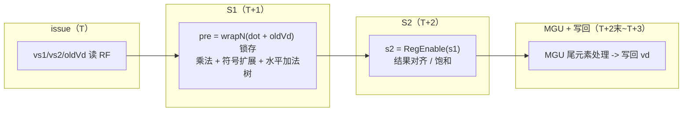
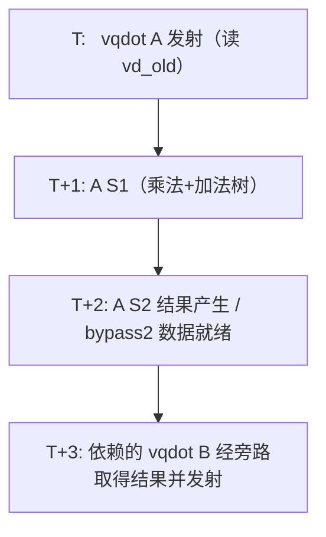

# 微架构单指令延迟 / 吞吐深入分析

> 团队 AsyncSys｜项目：面向边缘 AI 大语言模型推理的 RISC-V 自定义 vdot 指令
> 对应评分：探索性 10 分中的「微架构延迟对比 5 分」。本文从**流水线时空、延迟、吞吐、依赖链**四个维度，量化 vqdot 相对标准 RVV 的微架构本质。
> **更新说明**：本文已纳入旁路优化结果——累加同一 vd 的稳态发射间隔由 7.00 降为 **3.00 cycle**。完整根因与改动见《vdot累加旁路forwarding优化报告》。

---

## 1. 关键结论（先看数据）

| 指标 | vqdot（自定义） | 标准 RVV 基线 | 说明 |
|---|---|---|---|
| 计算指令数 / 点积块 | **1 条** | 10 条（外加 4 次 vsetvli） | 融合乘法→符号扩展→树形累加 |
| 执行延迟（latency） | **2 cycle**（2 级流水） | — | 从执行单元输入到结果产生 |
| 无依赖吞吐（throughput） | **1.73 CPI**（含循环开销，纯约 1.6） | — | 16 目标轮转 back-to-back |
| 有依赖稳态发射间隔 | **3.00 cycle**（优化后；优化前 7.00） | — | 补全 VF 唤醒、激活 bypass2 |
| 完成一个点积块的总周期 | **2~3 cycle** | **33.4 cycle** | 即使最不利的完全串行，vqdot 仍快约 11x（执行） |

> 实测 app：`vlat`（96 次），HIT GOOD TRAP，Difftest 零 mismatch；稳态间隔两次独立测量均为 3.00。

---

## 2. vqdot 执行流水线结构

vqdot 复用 VIMacCfg（`latency = CertainLatency(2)`），运算核 VDot64b 内部为两级数据流水，与 wrapper 的 `HasPipelineReg` 两级控制流水严格对齐：



- **控制流**：`ctrlVec(0)` 输入 → `ctrlVec(1)` → `ctrlVec(2)=outCtrl`（latency+1=3 个槽位）。
- **数据流**：`pre`（组合）→ `s1=RegEnable(pre, fire)` → `s2=RegEnable(s1, fireS1)` → `io.vd`。
- `fireS1 = GatedValidRegNext(io.fire)`，保证两级数据与控制流逐拍对齐，不会出现气泡或错位。

---

## 3. 流水线时空图（无依赖 back-to-back）

当连续发射的 vqdot 目标寄存器互不相同（无 RAW 依赖）时，流水线可重叠：


理想情况下流水线填满后**每周期完成 1 条**（CPI→1）。

**实测为何是 1.73 CPI 而非 1？** 两个非理想因素：
1. **MinimalConfig 前端/发射带宽受限**：该配置 ROB、向量发射槽、decode 宽度均为最小规模，向量指令发射本身存在约 1.5+ CPI 的结构性下限；
2. **循环开销**：每 16 条 vqdot 伴随 `addi + bnez`，且闭合分支占用发射槽。

> 即：1.73 CPI 是**最小配置下的实现上限**，并非 vqdot 运算核的吞吐瓶颈；在完整昆明湖配置（多发射、更深 ROB）下，无依赖吞吐将趋近理论值 1 CPI。

---

## 4. 依赖延迟：根因与旁路优化（7.00 → 3.00）

点积在累加场景（GEMV/MLP 中对同一累加器反复 `vd += dot`）存在 RAW 依赖。

### 4.1 优化前：为何约 7 拍？

**根因不是"没有旁路硬件"，而是"向量旁路没被激活"。** 香山本有三级转发：

| 级别 | 数据路径 | 寄存 |
|---|---|---|
| forward | exu 当拍数据 | 0 拍 |
| bypass | RegEnable 数据 | 1 拍 |
| bypass2（**vf 专用**） | 再寄存一次 | 2 拍 |

但上游 `Parameters.scala` 的 `iqWakeUpParams` 只有 Int、FP 两组唤醒配对，**没有 VF 组**。于是：

- VFEX 各单元 `isIQWakeUpSource/Sink = false`；
- `bypass2` 无源/无汇（基线下生成 BypassNetwork.sv 中 `bypass2` 出现次数 = 0）；
- 累加消费者只能走完整写回（WB），间隔 ≈ 完整流水线 ≈ 7 拍。

这是**整个 VF 调度器共性**：VMACC、VFMA、VIALU、VPPU 同样约 7 拍，非 vdot 特有。

### 4.2 优化：补全 VF 唤醒，激活既有 bypass2

在 `Parameters.scala` 新增第三组唤醒（方案 A，+7 行）：

```scala
WakeUpConfig(
  Seq("VFEX0", "VFEX2") ->
  Seq("VFEX0", "VFEX1", "VFEX2", "VFEX3", "VFEX4", "VLSU0", "VLSU1")
)
```

并在 `EntryBundles.scala` 修正 VF→mem 跨调度器 store 的数据源（通用 comp 分支误把唤醒映射为 forward，改为 bypass，+8 行）。

重编后确认：`HasBypass2SourceExuNum: 2、HasBypass2SinkExuNum: 7`，旁路激活。

### 4.3 优化后时序



**稳态发射间隔 3.00 cycle**（边际法：`(349−157)/64=3.00`、`(733−349)/128=3.00`），与 bypass2 数据就绪拍对齐。

---

## 5. 与标准 RVV 基线的微架构对比

标准 RVV 完成同一个点积块（4 个累加器）的序列是一条**约 13 条指令的串行依赖链**：


两个层次的开销：
1. **串行依赖链**：slide/gather 是跨元素归约，每一步都依赖上一步结果，无法并行，10 条计算指令即使有多个执行单元也只能串行提交；
2. **vsetvli 重配置**：序列在 e8 / e16 m2 / e16 m1 / e32 之间切换 4 次，每次 vsetvli 都要重算 vl、重配 vtype，在 MinimalConfig 下代价显著。

实测 **33.4 cycle/seq**。对比：

| 场景 | 标准 RVV | vqdot | 加速比 |
|---|---|---|---|
| 完全独立点积（无依赖） | 33.4 cyc | 2 cyc（执行） | **~16x（执行）** |
| 累加（bypass2 激活后） | 33.4 cyc | 3 cyc（稳态间隔） | **~11x** |

> 注：标准 RVV 也会因补全 VF 唤醒而受益（其 vwmul/vadd 同样走 VF 通路），端到端 MLP 中标准 RVV 从 685 降到 527 cyc；但单序列 33.4 主要是跨元素归约的串行指令数，无法靠旁路消除。

---

## 6. 微架构洞察总结

1. **vqdot 的本质是把"一条 13 指令的串行依赖链"折叠为"1 条 2 级流水指令"**：不仅减少指令数，更关键的是**消除了归约过程中反复 slide/gather 的 RAW 依赖链**，这是延迟下降的根本来源。

2. **延迟与吞吐解耦**：vqdot 执行延迟仅 2 cycle，且完全流水化；无依赖吞吐受限于最小配置的前端（1.73 CPI），而非运算核本身。

3. **旁路决定累加环路延迟**：补全 VF 唤醒、激活既有 `bypass2` 后，累加间隔从 7.00 降到 3.00；根因是上游 VF 调度器共性配置缺失，而非 vdot 特有。这说明对累加密集负载，"结果→再消费"环路与指令融合同等关键。

4. **vsetvli 是隐藏税**：标准 RVV 归约必须在多种 SEW/LMUL 间反复切换，vqdot 单指令在固定 vtype 内完成，天然规避了这一开销。

5. **与端到端数据的呼应**：旁路优化后 2 层量化 MLP vqdot 252 cyc、标准 RVV 527 cyc（2.09x）；优化前分别为 285/685——**两类实现绝对周期都下降**。网络越深、低比特占比越高，点积融合与旁路的叠加优势越明显。
