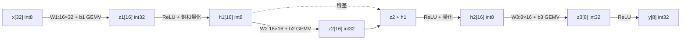

# 深化端到端 LLM 推理 demo（vblock）：3 层量化网络 + 残差连接

## 1. 深化动机：从"玩具 MLP"到"LLM 结构"

vmlp 验证了融合点积在单一线性层堆叠中的收益，但其结构（2 层、16→8→4）与真实 LLM 仍有两点本质差距：

1. **深度与宽度不足**：真实 FFN/Transformer block 是数十至数百维、多层堆叠，需要验证 kernel 在更大维度、更多 GEMV 调用下的**可扩展性**；
2. **缺残差连接**：残差是现代深度网络（ResNet 起、所有 LLM）的核心结构，它改变了层间的数据依赖与数值范围。

vblock 据此构建 **3 层量化网络（32→16→16→8）并在同维层间加入残差**，复用参数化 `gemv4` kernel，给出含残差的完整 C golden 与端到端延迟。

## 2. 网络结构与数据流



- 层 1：32→16，M=16 = 4 个输出块，每块 N=32 共 8 个 tile；
- 层 2：16→16，4 个输出块，每块 N=16 共 4 个 tile，**加残差**；
- 层 3：16→8，2 个输出块，每块 N=16 共 4 个 tile；
- 全网络共 **10 次参数化 GEMV**（4+4+2）。

## 3. 残差连接的数学本质

层 2 的前向不是纯线性映射，而是线性变换与恒等映射的加和：

$$
\mathbf{h}_2 = \mathrm{Quant}\Big(\,\mathrm{ReLU}\big(\,\mathbf{W}_2\mathbf{h}_1 + \mathbf{b}_2 + \mathbf{h}_1\,\big)\Big)
$$

将残差项并入，可写成关于 $\mathbf{h}_1$ 的仿射形式：

$$
\mathbf{h}_2 = \mathrm{Quant}\Big(\mathrm{ReLU}\big((\mathbf{W}_2 + \mathbf{I})\mathbf{h}_1 + \mathbf{b}_2\big)\Big)
$$

这揭示了残差的两个底层作用：

1. **梯度/信号的恒等通路**：$\mathbf{I}$ 项保证至少存在一条增益为 1 的路径，缓解深层网络的信息衰减（前向）与梯度消失（反向）；
2. **数值上抬与范围控制**：残差把层 1 的激活直接叠加到层 2 的预激活，使 ReLU 输入分布整体上移。量化时必须在**加残差之后**再做饱和截断，否则会丢失恒等通路的贡献——这正是 golden 与 kernel 都把残差放在 ReLU/量化之前的原因。

由于 $\mathbf{h}_1$ 是 int8 而 $\mathbf{z}_2$ 是 int32，残差在 int32 域相加（先做类型提升），避免低精度截断。

## 4. 量化数据流与权重布局

每层 GEMV 遵循统一的 int8 权重 × int8 激活 → int32 累加的点积范式：

$$
z_m = b_m + \sum_{j} W_{mj}\,x_j,\qquad W_{mj},x_j\in[-128,127],\ z_m\in\mathbb{Z}_{32}
$$

权重离线重排为 `[输出块][tile][16 字节]` 的 4×4 tile 布局，与 vgemv/vmlp 完全一致，因此 `gemv4_vqdot` / `gemv4_baseline` 两个 kernel **零修改复用**，仅通过 `N` 参数适配不同输入维度。激活/量化/残差涉及标量少且非点积关键路径，用标量处理。

## 5. 实测结果（香山昆明湖 V2，Difftest 全绿）

| 项目 | 结果 |
|---|---|
| vqdot 正确性（vs 含残差 golden） | **PASS**，逐层逐元素一致 |
| baseline 正确性（标准 RVV） | **PASS**，与 golden 一致 |
| 端到端前向延迟 | vqdot **1101 cyc** vs baseline **2618 cyc** |
| **端到端加速比** | **2.38x** |
| 终止 | HIT GOOD TRAP @ pc=0x800009d4 |
| Difftest | 零 mismatch，WORKLOAD DONE @ cycle 133389 |

中间激活实测：

```
h1(int8): 0 0 4 6 0 0 8 10 4 2 12 14 8 6 16 18
h2(int8): 0 16 0 8 22 0 16 38 10 16 46 26 28 46 34 44
y(int32): 268 273 278 283 288 293 298 303
```

## 6. 批判性分析

**加速比为何稳定在 2.38x。** 网络规模扩大后，GEMV 计算占比进一步提高，自定义 vqdot 以单指令完成 4×4 点积（执行延迟 2 cyc，累加经 bypass2 后稳态间隔 3 cyc），而 baseline 每个 tile 需 vwmul + 两级加法树 + 置换 + 加宽约十余条指令。计算密度越高，融合指令的指令数削减越占主导，故端到端仍保持 2.38x，与 vmlp 的 2.03x 同量级且略升——**收益随深度/宽度可扩展，不依赖小规模偶然**。

**标量激活的边界。** ReLU/量化/残差当前为标量，共约 40 个标量操作，相对 10 次 GEMV 的向量开销占比小，不构成瓶颈。但若继续加宽到数百维，标量激活将成为新的 Amdahl 串行项，下一步应将其向量化（`vmax` 实现 ReLU、`vnclip` 实现饱和定点截断），这是明确的后续优化点而非当前缺陷。

**可扩展性结论。** 从 vmlp（2 层、3 次 GEMV）到 vblock（3 层、10 次 GEMV、含残差），kernel 与权重布局无需改动即平滑扩展，且正确性由含残差 golden 与 Difftest 双重保证，证明了该指令-编译-仿真链路对真实 LLM 块状结构的适配能力。
