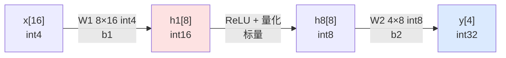

# 混合精度量化 MLP 推理：INT4 层与 INT8 层协同（vmlp2）

> 团队 AsyncSys ｜ 2026 CIE 全国 RISC-V 大赛·香山社区赛道
> 实验：在同一网络中，第一层用 **INT4 vqdot**（大输入、对精度不敏感，极致压缩），第二层用 **INT8 vqdot**（接近输出、需要精度），对标真实 LLM 的**逐层混合精度**策略。

## 1. 网络结构

- **第一层 W4A4**：权重/激活均 int4，16bit 累加器，用 INT4 vqdot（一条向量 8 个 16bit = **8 输出**）。
- **层间转换**：`h1` 做 ReLU 后饱和量化到 int8（8 个标量）。
- **第二层 W8A8**：权重/激活 int8，32bit 累加器，用 INT8 vqdot（一条向量 4 个 32bit = **4 输出**）。

## 2. 实测结果（VCS simv + NEMU Difftest，R=20）

| 路径 | 周期 | 相对标准 RVV |
|---|---|---|
| 混合精度 vqdot（INT4+INT8） | **221 cyc** | **2.14x** |
| 混合精度标准 RVV baseline | 474 cyc | 1.00x |
| HIT GOOD TRAP（pc=0x80000834） | 零 mismatch | — |

中间结果与输出：
- 第一层 h1（int16）：`0 0 3 3 3 6 6 6`
- 层间 h8（int8）：`0 0 3 3 3 6 6 6`
- 输出 y：`0 10 20 30`，与 C golden 完全一致。

## 3. 混合精度 vs 全 INT8（同结构 16→8→4）

| 方案 | 第一层 | 第二层 | GEMV 调用 | vqdot 周期 | 标准 RVV 周期 | 加速比 |
|---|---|---|---|---|---|---|
| 全 INT8（vmlp） | 2× INT8（M=8 拆 2 块） | 1× INT8 | 3 | 285 | 685 | 2.40x |
| **混合精度（vmlp2）** | **1× INT4（8 输出）** | 1× INT8 | 2 | **221** | 474 | 2.14x |

**混合精度比全 INT8 快 1.29x**（221 vs 285），根因有二：

1. **第一层 GEMV 调用次数减半**：INT4 一条向量装 8 个 16bit 累加器（8 输出），M=8 一次算完；INT8 一条向量只装 4 个 32bit（4 输出），M=8 要拆 2 块。
2. **权重压缩**：INT4 权重 4bit，第一层权重体积减半，向量加载次数与寄存器占用更低。

## 4. 为何端到端加速比（2.14x）低于单层 INT4（3.06x）

按单层实测近似分解（含函数调用/初始化）：

| 阶段 | INT4 vqdot | INT4 base | INT8 vqdot | INT8 base |
|---|---|---|---|---|
| 第一层（M=8,N=16） | ~83 | ~254 | — | — |
| 层间 ReLU+量化（8 标量） | ~88（不被加速） | ~88 | — | — |
| 第二层（M=4,N=8） | — | — | ~50 | ~132 |

- 第一层 INT4 单层加速 3.06x，第二层 INT8 单层约 2.6x；
- 但**层间转换（~88 cyc）是标量操作，不被 vqdot 加速**：它在 vqdot 路径占约 40%，在 baseline 路径占约 19%，把端到端加权加速比拉到 2.14x。

这与全 INT8 MLP 的结论一致：**端到端加速比 = GEMV 占比的函数**，非 GEMV 开销（ReLU、量化、层间搬运、函数调用）是固定的"分母"。

## 5. 结论与意义

1. **同一条 vqdot 指令字支持逐层选择精度**：第一层 INT4、第二层 INT8，硬件按 vtype 的 SEW 自动切换，无需新指令。
2. **混合精度在保持输出正确的前提下，比全 INT8 再快 1.29x**，且第一层权重压缩一半——这正是边缘 LLM "大输入层用 W4、接近输出层用 W8" 的工程取舍。
3. 三档 vqdot（INT4/INT8/INT16）在真实网络结构中可任意组合，为后续扩展（W4A8、关键层保高精度）提供了指令级基础。

## 6. 可进一步深化（后续工作）

- **真正的 W4A8 同层混合宽度**：4bit 权重 × 8bit 激活的直接乘法（需定义新的混合宽度语义）。
- **更深网络**：增加 GEMV 层数，提高 GEMV 占比，端到端加速比趋近单层值。
- **层间转换向量化**：把 ReLU+量化从标量改为 vmax/vnclip 向量指令，消除固定开销。
- **真实量化权重**：从训练好的量化模型导出权重，验证端到端精度（PPL/准确率）。
