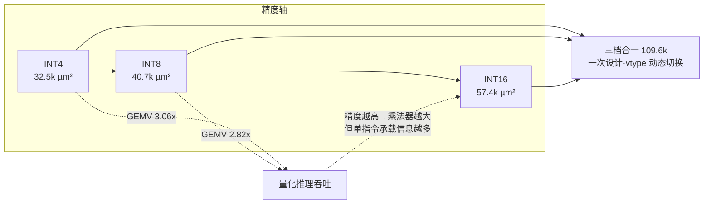

# 精度—面积—性能权衡分析：vdot 三档整数点积

> CIE2026 AsyncSys · 工艺：SMIC 0.18µm（scc018ug_uhd_rvt，tt 1.8V/25℃）
> 综合：Design Compiler V-2023.12-SP3，**`compile_ultra -no_autoungroup`**（DW 乘法器展开优化）
> 口径：单个 64bit 运算模块 `VDot64b`；VIMacU 内例化 2 个该模块。

## 1. 三档面积与时序（单 64bit 模块）

| 点积精度 | 子元素 | 组合面积 (µm²) | 时序单元面积 (µm²) | **总面积 (µm²)** | 等效门数* | 关键路径 |
|---|---|---|---|---|---|---|
| **INT4**（SEW=16） | 4bit | 27,076 | 5,453 | **32,529** | ≈4,322 | 1.73 ns |
| **INT8**（SEW=32） | 8bit | 35,566 | 5,097 | **40,663** | ≈5,403 | 1.73 ns |
| **INT16**（SEW=64） | 16bit | 51,975 | 5,453 | **57,428** | ≈7,631 | 1.74 ns |
| **三档合一**（运行时按 vtype 选） | — | 103,772 | 5,825 | **109,598** | ≈14,562 | 1.77 ns |

\* 以 NAND2UHDV1 面积 7.5264 µm² 折算。每档均 129 个时序单元（两级流水寄存器）。

## 2. 三档性能（端到端，cycle，vqdot vs 标准 RVV 基线）

| 场景 | INT8 | INT4 |
|---|---|---|
| 纯计算累加（N=10） | 8 / 37 = **4.62×** | — |
| 点积微基准（R=5） | 70 / 114 = **1.63×** | 59 / 110 = **1.86×** |
| GEMV 线性层 | 85 / 240 = **2.82×** | 83 / 254 = **3.06×** |
| 2 层量化 MLP（端到端） | **2.40×**（285 / 685） | — |

## 3. 权衡关系（Mermaid）

## 4. 关键结论

1. **面积随子元素位宽近似平方增长**：乘法器硬件复杂度 O(n²)。INT4→INT8→INT16 面积
   32.5k→40.7k→57.4k，增量主要来自乘法器阵列；流水寄存器（129 FF）三档基本不变。
2. **三档合一面积 109.6k，小于三档之和（130.6k）**：组合逻辑（乘法器/加法树）不共享，
   但两级流水寄存器与少量控制逻辑共享，且 firtool/DCE 消除了未用路径。
3. **关键路径稳定在 1.73–1.77ns**：瓶颈是"乘法→树形累加"的组合链，三档与合一都满足
   2ns 时钟约束（slack MET），说明参数化设计未牺牲频率。
4. **低位宽性价比更高**：INT4 面积最小、GEMV 加速比反而最高（3.06×），契合边缘量化
   推理（W4/W8）的算力/面积诉求；INT8 是精度与通用性的平衡点；INT16 面向未量化/
   高精度中间结果。
5. **单指令 vs 多指令的本质**：标准 RVV 是 SIMD 宽元素模型，点积这种跨元素归约需反复
   slide/gather + 多条 vadd；vqdot 把"4 路乘法→符号扩展→树形累加"折叠进单指令，
   纯计算场景最高 4.62×，端到端受非 GEMV 开销（ReLU/量化/搬运）摊薄到 2.4–3.1×。

## 5. 面积口径说明（避免误读）

- 普通 `compile` 会**保留 DW02_mult 层次结构**（每个 9×9 乘法器约 7,600µm²），
  得到的数字约为优化值的 2 倍（int8 78,376 等），**不是真实优化面积**。
- 本文统一采用 `compile_ultra -no_autoungroup`，DW 乘法器被展开为优化门级
  （单个 9×9 约 3,390µm²），与早期 INT8 独立报告 40,748µm² 一致。
- 本报告为**单 64bit 模块**口径；VIMacU 含 2 个模块，整体 VDot 数据通路面积约
  为表中数值的 2 倍（不含 MGU/控制）。
