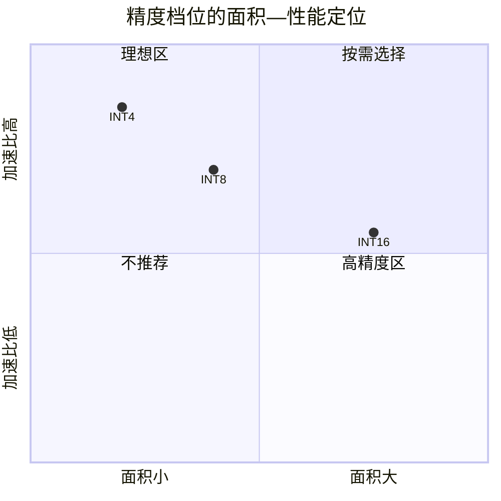

# 精度—面积—性能三维权衡分析报告

> 团队：AsyncSys　|　项目：面向边缘 AI 大语言模型推理的 RISC-V 自定义 vdot 指令设计（香山昆明湖 V2）
> 工艺：SMIC 0.18µm 典型角（scc018ug_uhd_rvt_tt_v1p8_25c，1.8V/25℃）　|　综合：Design Compiler `compile_ultra -no_autoungroup`
> 参考门：NAND2UHDV1 = 7.5264 µm²

---

## 1. 三档点积的面积（同口径，均 129 个触发器）

| 精度档位 | 对应 SEW | 每累加器打包子元素 | 组合面积 µm² | 时序面积 µm² | **总面积 µm²** | **折合 NAND2 门** |
|---|---|---|---|---|---|---|
| **INT4** | 16 | 4 × int4 | 27,076 | 5,453 | **32,529** | **4,322** |
| **INT8** | 32 | 4 × int8 | 35,566 | 5,097 | **40,663** | **5,403** |
| **INT16** | 64 | 4 × int16 | 51,975 | 5,453 | **57,428** | **7,630** |
| **合一（三档复用）** | 运行时选 | 上述全部 | 103,772 | 5,825 | **109,597** | **14,562** |

> 面积排序：INT4 < INT8 < INT16，比例约 **1 : 1.25 : 1.77**。
> 面积随子元素位宽近似平方增长——乘法器是面积主体，而乘法器面积 ≈ O(n²)。

---

## 2. 三档性能（端到端实测加速比，相对标准 RVV 基线）

| 精度 | 微基准（点积） | 纯计算累加 | GEMV 线性层 | 端到端网络 |
|---|---|---|---|---|
| INT8 | 1.63x（70/114 cyc） | 4.62x（8/37） | **2.82x（85/240）** | MLP 2.40x |
| INT4 | 1.86x（59/110 cyc） | — | **3.06x（83/254）** | — |
| INT16 | 功能 183 组 PASS（基线序列更长，收益预期更高，未实测） | — | — | — |

> 精度越低，单条指令打包的有效乘加越多、标准 RVV 基线归约开销占比越大，故 **INT4 加速比最高（3.06x）**。

---

## 3. 合一参数化 vs 三档独立的面积账

三档独立实现总面积之和 = 40,663 + 32,529 + 57,428 = **130,620 µm²**
合一参数化实现 = **109,597 µm²**，**节省 21,023 µm²（16.1%）**。

| 节省来源 | 金额 µm² | 本质 |
|---|---|---|
| 共享一套两级流水寄存器 | ~10,178 | 三档独立需 3 套流水 FF；合一仅 1 套（129 FF） |
| 统一模式选择与 Mux | ~10,845 | 三档独立各含完整选择逻辑；合一集中为 SEW 译码后一套 Mux |

**合一的代价**：关键路径多一级 SEW 模式选择 Mux，slack 由单档 0.05~0.06 ns 收紧到 0.02 ns（2 ns 周期下仍 MET，无违例）。

---

## 4. 设计取舍结论（边缘 LLM 推理视角）

- **INT4（W4 量化）**：面积最小、加速比最高，适合权重/带宽受限的边缘端极致压缩场景；代价是 4 bit 动态范围小，深层累加需更宽累加器（当前 16 bit，列为未来工作）。
- **INT8（W8 量化）**：面积仅增 25%、精度显著更好，是**通用量化推理的最佳平衡点**，也是当前工业界边缘 LLM 主流。
- **INT16（W16）**：面积最大，用于对精度敏感、无法承受量化误差的层（如归一化、首尾层），可与 INT8/INT4 混合精度使用。
- **合一参数化**：以 16% 的面积折扣让**一条指令字覆盖三档精度**，运行时由 `vtype` 的 SEW 选择，无需修改译码；这是本项目"软硬件协同"的核心——硬件只增加可控的模式 Mux，软件/编译器即可按层自由切换量化精度。

---

## 5. 方法论说明（口径与可复现性）

1. **为何用 `compile_ultra`**：普通 `compile` 会保留 DesignWare `DW02_mult` 通用乘法器（18×18，约 7,600 µm²/个）；`compile_ultra` 会结合目标库将其展开优化为门级（约 3,390 µm²/个），更贴近真实实现。所有四档均用同一命令，保证口径一致。
2. 单档 SV 由 `GenModes.scala`（`circt.stage.ChiselStage.emitSystemVerilog`，elaboration-time 参数 `onlyMode`）生成，从源头保证只含一档逻辑，而非靠综合器裁剪。
3. 所有数字均为 DC 实测，可由 `syn/syn_modes2.tcl` 一键复现；当前为 0.18µm 综合库的**相对评估**，绝对面积随工艺等比缩小，不影响三档间的相对结论。
