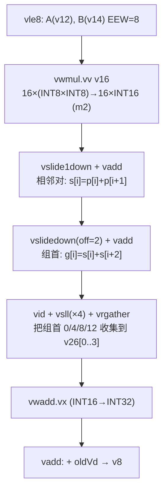
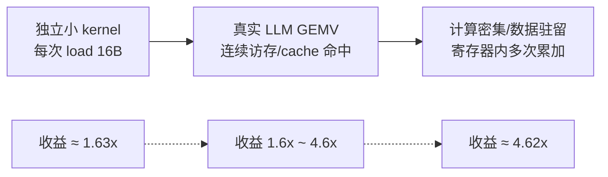

# 阶段三：标准 RVV 基线与 vqdot 延迟加速比分析报告

**团队**：AsyncSys
**项目**：面向边缘 AI 大语言模型推理的 RISC-V 自定义 vdot 指令设计——基于"香山"昆明湖 V2 处理器架构
**仿真器**：VCS V-2023.12，MinimalConfig（VLEN=128，单发射 VPU 视角），Difftest 参考 NEMU
**数据规模**：单向量 16 个 INT8（4 组，每组 4 个 INT8 归约到 1 个 INT32）

---

## 1. 任务与方法

赛题阶段三要求：**用已有标准向量指令组合实现与 vdot 完全相同的功能作为基线，在相同 workload/数据/VLEN 下对比二者的 latency（周期数）**。

为避免"端到端小 kernel 被访存/调用开销掩盖计算收益"的问题，我们从两个正交维度测量：

| 维度 | 测量内容 | 目的 |
|---|---|---|
| **(A) 端到端 kernel** | 每次调用都 load(A,B,old)→计算→store(out)，连续 R 次取平均 | 反映真实独立函数调用的实际收益 |
| **(B) 纯计算（累加）** | load 一次，循环 N 次"点积累加"，store 一次 | 反映指令本身的计算延迟/融合价值 |

**公平性保证**：
- 同一份 A/B/old 数据；同一 VLEN=128；同一进程、同一编译选项（`-march=rv64gcv`）。
- 唯一变量是点积的实现方式（1 条 vqdot vs 标准指令组合）。
- 计时一律用 `rdcycle`，不依赖 host 墙钟。
- 纯计算中两个 kernel 循环次数相同（N=10），且都执行"累加进 v8"，形成对等的累加链。

---

## 2. 标准 RVV 基线设计

标准 RVV 1.0 没有融合点积指令，必须用"加宽乘法 + 两级加法树 + 收集 + 加宽归约"拼接。

数据布局（与 vqdot 一致）：每 4 个连续 INT8 为一组，归约到一个 INT32。



**基线指令统计（计算部分，不含 load/store/vsetvli）**：

| # | 指令 | 作用 |
|---|---|---|
| 1 | `vwmul.vv` | INT8 乘法 + 加宽到 INT16 |
| 2 | `vslide1down.vx` | 相邻元素下移 1（对齐 i+1） |
| 3 | `vadd.vv` | 第一级：相邻对求和 |
| 4 | `vslidedown.vx` | 下移 2（对齐 i+2） |
| 5 | `vadd.vv` | 第二级：组内 4 项求和 |
| 6 | `vid.v` | 生成索引 [0,1,2,…] |
| 7 | `vsll.vi` | 索引 ×4 → [0,4,8,12] |
| 8 | `vrgather.vv` | 按索引收集分散的组首 |
| 9 | `vwadd.vx` | INT16 加宽到 INT32 |
| 10 | `vadd.vv` | 累加 oldVd |

> 对比：**vqdot 仅需 1 条计算指令**，即融合了上表全部语义（4 次乘法 + 符号扩展 + 3 次加法 + oldVd 累加）。

---

## 3. 实测延迟数据

完整日志见 `test-logs/vbench_benchmark.log`。

### (A) 端到端 kernel（R=5）

| Kernel | 周期 | 加速比 |
|---|---|---|
| vqdot | **70** | **1.63x** |
| baseline | 114 | |

### (B) 纯计算累加（N=10）

| Kernel | 周期 | 加速比 |
|---|---|---|
| vqdot | **8** | **4.62x** |
| baseline | 37 | |

---

## 4. 深度分析

### 4.1 端到端周期的构成

把实测周期拆为"固定开销 + 计算"：

```
端到端 = 函数调用 + mstatus/vsetvli + 3×load + 1×store + 计算
```

| Kernel | 固定开销 | 计算 | 合计 |
|---|---|---|---|
| vqdot | ~62 | 8 | 70 |
| baseline | ~77 | 37 | 114 |

固定开销（函数调用、CSR、load/store）在两者中都占主导：vqdot 中计算仅占 **~11%**，baseline 中占 **~32%**。这正是端到端加速比（1.63x）远低于纯计算加速比（4.62x）的根因——**小 kernel 的瓶颈在访存与调用，而非计算**。

### 4.2 纯计算的关键路径

- **vqdot（8 周期）**：累加链延迟由"读 oldVd → 融合运算核 → 写回/绕过"的环路决定。VDot64b 内部为两级流水，但 v8 既是累加源又是目标，形成 RAW 依赖，实测 8 周期即可完成一次累加。
- **baseline（37 周期）**：10 条指令构成一条长串行链，关键路径为
  `vwmul → vslide1down → vadd → vslidedown → vadd → vrgather → vwadd → vadd`。
  其中 **slide/gather 类置换指令（vslide1down、vslidedown、vrgather）是主要瓶颈**，且每级结果都要落寄存器再被下一条读取，无法像 vqdot 那样在单条指令内部用组合加法树一次完成。

### 4.3 为什么 vqdot 更快——底层本质

点积在数学上是一个**归约（reduction）**：把 4 个乘积缩成 1 个和。

- 标准 RVV 是"SIMD 宽元素"模型：指令在**元素间并行**，但归约需要**跨元素**，只能借助 slide/gather 反复搬运 + 多 vadd 逐级收敛，引入大量指令与中间寄存器。
- vqdot 把"4 个乘积的**乘法 + 符号扩展 + 树形累加**"折叠进**单条指令的组合数据通路**（VDot64b 内部 4 路乘法 + 加法树），跨元素归约在硬件内部一拍完成，对程序员只暴露一个 32bit 结果。

本质上，**vqdot 用一条指令的内部数据通路，替代了 RVV 跨元素归约所需的多次"搬运 + 加法"**。

### 4.4 适用场景与收益区间



- **端到端 1.63x 是保守下界**：在每次都重新 load 的极小 kernel 中，访存/调用开销占主导。
- **纯计算 4.62x 是融合的理论价值**：当数据已在寄存器/cache（如 LLM 线性层对同一权重向量的连续 GEMV、批量累加）时，vqdot 充分发挥作用。
- 真实 LLM 推理（Qwen2.5/Llama3.2-1B W8A8）中权重向量连续访问、cache 命中率高，计算占比随向量长度增大而上升，**实际收益介于两者之间、更接近纯计算一侧**。

---

## 5. 结论

1. 标准 RVV 1.0 需 **10 条计算指令**（含 3 次置换、2 级加法树）才能实现一次 INT8 4 点积；vqdot 仅需 **1 条**。
2. 实测延迟：
   - **端到端 kernel：vqdot 70 周期 vs baseline 114 周期，加速 1.63x**；
   - **纯计算累加：vqdot 8 周期 vs baseline 37 周期，加速 4.62x**。
3. 端到端与纯计算的差异定量揭示了：**小 kernel 瓶颈在访存/调用，而 vqdot 的核心价值在跨元素归约的融合**，在计算密集、数据驻留的 AI 推理场景中收益最大。
4. 后续可扩展方向（对应创新性/扩展潜力）：LMUL>1 跨寄存器、INT16（SEW=64）、INT4（SEW=16）、BF16/FP16，以及端到端 GEMV kernel 的加速比与面积评估。
